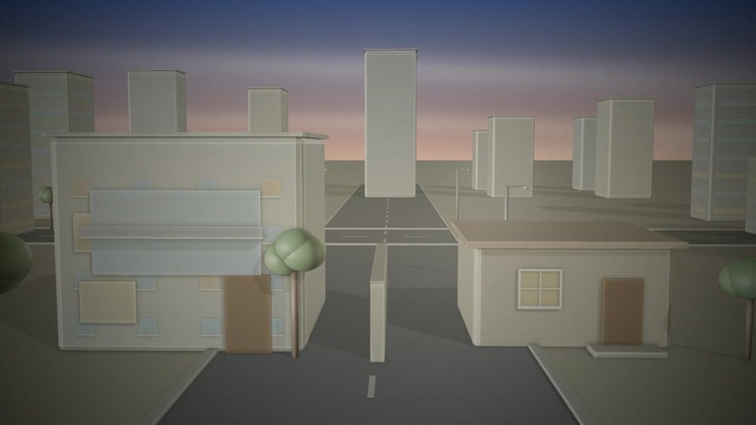
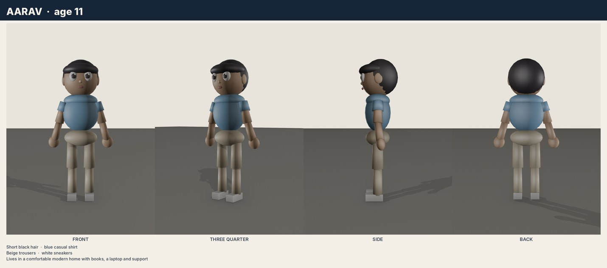
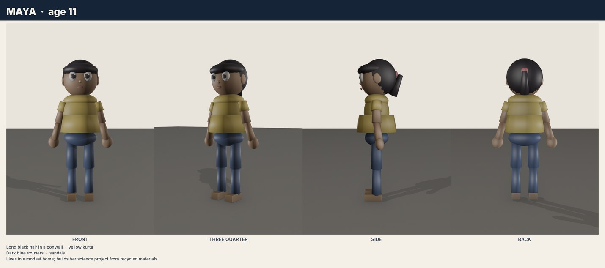
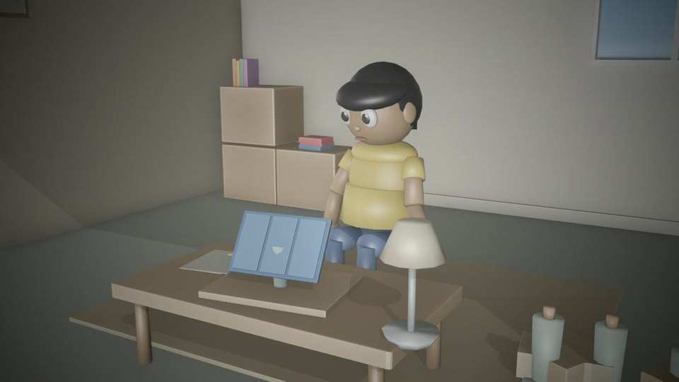
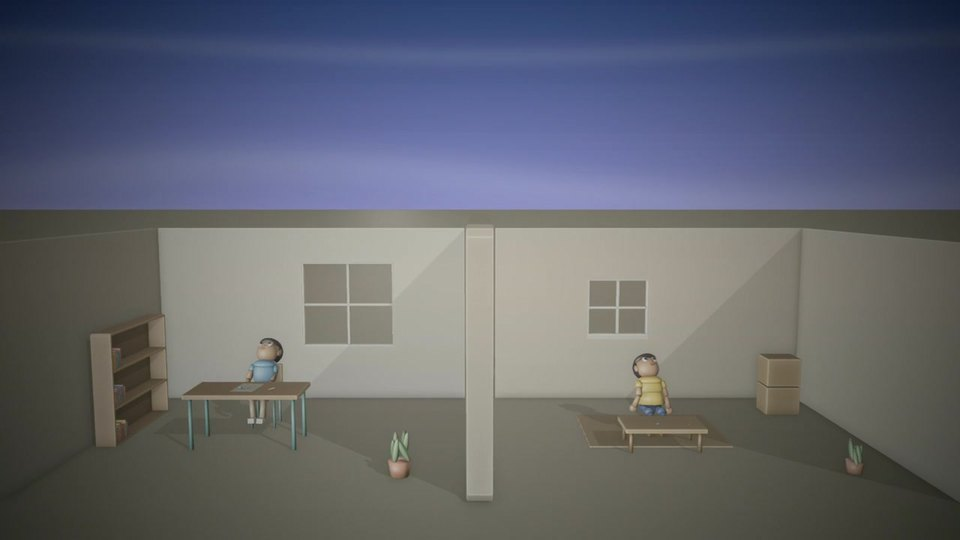
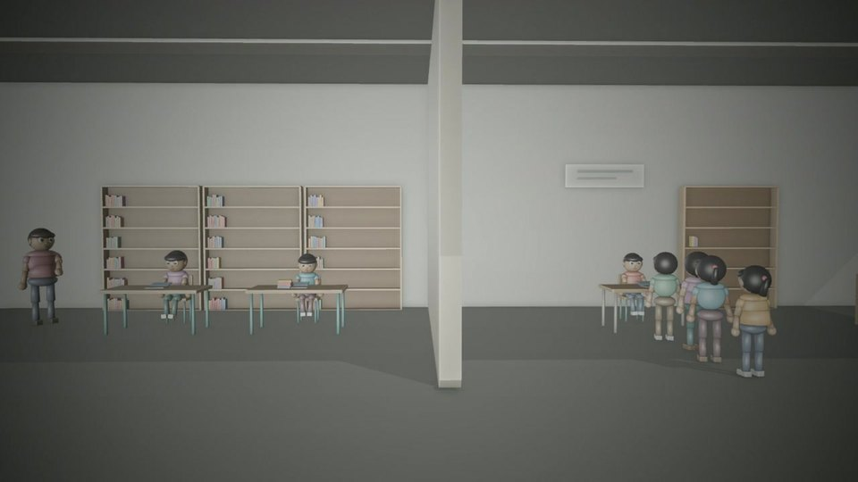
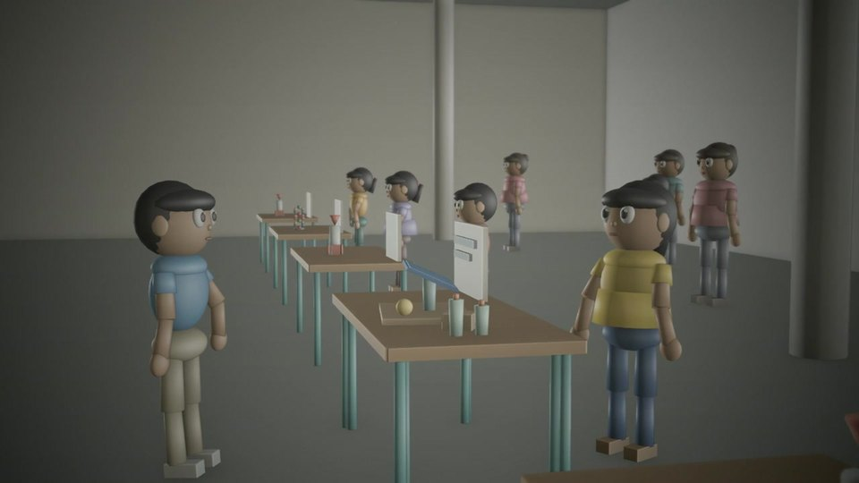
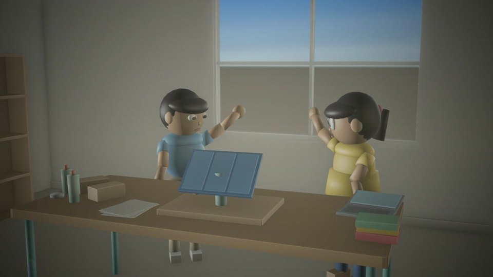
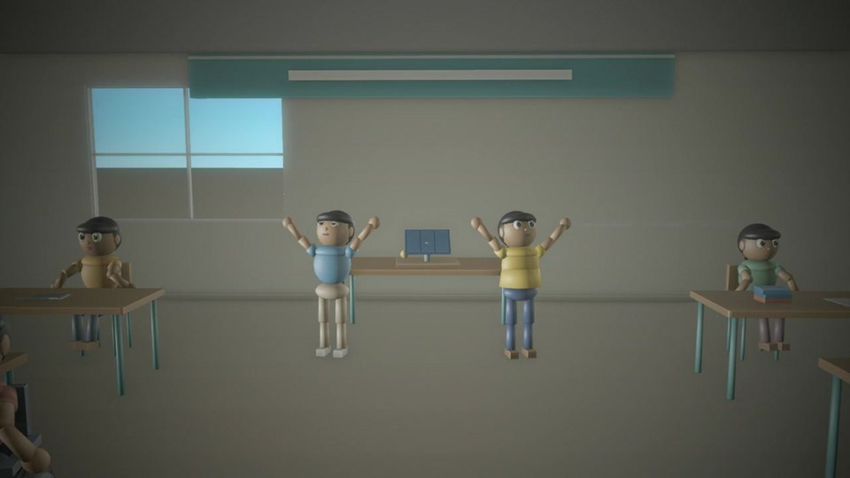

# BEHIND TWO WINDOWS

**An original 2 min 47 s 3D animated short on UN SDG 10 — Reduced Inequalities**

> *Different beginnings. Equal dreams. One shared future.*

Created and presented by **Anvith & Hitesh**
21CSE255T — Computer Graphics and Animation — LLT-1



---

## The film

Aarav and Maya are both eleven. They live in the same Indian city, look at the same sky, and
both want to be scientists. Aarav has a laptop, a wall of books and a parent who brings him
more. Maya has the same curiosity, and builds a working solar tracker out of plastic bottles
and cardboard.

Their paths cross at a community science exhibition. They build together as equals, and the
community turns that into an inclusive learning centre open to every child.

**The rule we set ourselves:** inequality appears only as unequal *access* — a queue for one
shared computer, a shelf with three books, a borrowed table. Maya is never portrayed as
helpless, and poverty is never used as a costume.

| | |
|---|---|
| Runtime | 2 min 47 s (167.4 s) |
| Format | MP4 — H.264 + AAC |
| Resolution | 1920 × 1080, 24 fps |
| Sequences | 10, cross-dissolved |
| Frames rendered | 4,104 |

---

## Everything here is generated by code

There is no stock footage, no downloaded model, no generated image and no sampled music in
this film. Every character, prop, building, camera move, musical note and sound effect is
produced by the Python in `src/`.

```
1  Script      10 narration lines written to the SDG 10 brief
2  Voice       Kokoro-82M neural TTS, offline → 10 WAV files + measured lengths
3  Timeline    shot lengths derived from the voice lengths (10 shots = 2:47)
4  3D build    Blender bpy: rigs, sets, props, cameras — all from code
5  Render      Workbench engine, transparent film, 1280×720 @ 24 fps
6  Composite   sky, haze, bloom, grade, vignette, grain → upscaled to 1080p
7  Mix & edit  cross-dissolves, title cards, score + SFX ducked under narration
```

### Characters




Both leads come from a single parametric constructor, so every shot instantiates identical
geometry, colours and proportions — character drift is impossible by construction. They are
posed through a 13-joint puppet hierarchy (`root → pelvis → spine → neck → head`, plus two
arms and two legs) built from parented empties, stop-motion style rather than a skinned
armature. A pose is one line:

```python
aarav.pose(f, r_sh=(-64, -26, 0), r_elb=(28, 0, 0))
aarav.walk(1, sec(6.4), (-7.5, 5.6, 0), (2.0, 5.9, 0), cycle=17, stride=26)
```

### The look

The 3D is rendered on a **transparent film** with Blender's Workbench engine; the sky,
atmospheric haze, bloom, colour grade, vignette and grain are composited afterwards in
FFmpeg. Nine per-sequence "moods" in `look.py` carry the colour arc of the story — warm
dawn, bright home, cooler modest home, dream, neutral contrast, exhibition hall, golden,
bright, sunset.

| | |
|---|---|
|  |  |
|  |  |
|  |  |

### Audio

| Element | How |
|---|---|
| **Narration** | Kokoro-82M neural TTS, offline via ONNX. Voice `af_heart` at 0.90 speed |
| **Score** | Synthesised from scratch in NumPy — no samples, no loops. Felt piano (inharmonic partials + hammer noise), string ensemble (5-way detune + vibrato), warm pad, harp, timpani, convolution reverb from shaped noise |
| **Effects** | Morning birds (FM chirps), city and room tone, footsteps, pencil on paper, a servo for the solar tracker, crowd murmur from banded noise bursts, applause built from ~230 individual claps |
| **Mix** | Score and effects side-chain compressed against the voice, so they duck when the narrator speaks and swell in the gaps |

Previews in [`audio_preview/`](audio_preview). Musical arc: soft piano (0:00) → strings enter
(0:50) → yearning and sparse (1:03) → hope returns (1:19) → building (1:37) → full crescendo
(2:11) → gentle piano close (2:28).

---

## Repository layout

```
src/                 every script that builds the film
blend/               openable Blender scenes, one per sequence  (see OPEN_IN_BLENDER.md)
characters/          Aarav and Maya reference sheets
stills/              one frame per sequence
audio_preview/       MP3 previews of the score, effects and narration
docs/                production summary + the 12-slide presentation
```

| File | What it does |
|---|---|
| `src/rig.py` | Character construction, the joint hierarchy, posing, walk cycle, blinks |
| `src/sets.py` | Parametric furniture, props, buildings, the city with 3 levels of detail |
| `src/shots.py` | The ten sequences — staging, performance and camera, one function each |
| `src/look.py` | Render configuration and the nine colour moods; paints the skies |
| `src/render3d.py` | Builds, renders and composites a shot |
| `src/audio10.py` | Narration, the orchestral score and the effects bed |
| `src/titles.py` | Title and end-credit cards |
| `src/assemble10.py` | Cross-dissolves, title overlays, the audio mix, final export |

---

## Running it

```bash
pip install bpy numpy scipy pillow soundfile kokoro-onnx     # plus FFmpeg on PATH

python3 src/audio10.py all                 # narration, score, effects
python3 src/render3d.py shots S01 S02 S03 S04 S05 S06 S07 S08 S09 S10
python3 src/assemble10.py                  # edit, titles, mix → BEHIND_TWO_WINDOWS.mp4
```

Changing one sequence re-encodes only that sequence; the rest is stream-copied.

Preview a single frame without rendering the whole shot:

```bash
python3 src/render3d.py still S06 230      # → preview/S06_0230.jpg
python3 src/render3d.py probe S06          # 3 frames + a timing estimate
```

### Opening it in Blender

The `.blend` files in `blend/` were written by **Blender 5.3** and need 5.3 or newer.
On an older Blender, build the scene from the scripts instead — see
[`blend/OPEN_IN_BLENDER.md`](blend/OPEN_IN_BLENDER.md) for both routes.

---

## Notes on the constraints

This was produced on a **2-core CPU with no GPU**, which shaped most of the technical choices:

* **EEVEE** could not initialise (no GPU) and **Cycles** measured 9.4 s/frame at 720p —
  about eleven hours for the film. The whole look was therefore designed around the
  Workbench rasteriser, with the atmosphere added in post. Final cost: **2.6 s/frame**.
* The first version of the city gave every building its own windows — ~25,000 objects and
  **47 s/frame**, over five hours for one shot. Three levels of detail (individual windows /
  per-floor strips / plain blocks) brought it to **2.4 s/frame** with no visible difference
  at that camera distance.
* Anti-aliasing was tuned down to the point where the added film grain hides the difference,
  and frames render at 720p with the upscale handled in the composite.

Two bugs worth recording, since both produced completely wrong output rather than an error:

* The first `aim_at()` pointed the camera **backwards** — every early test frame was an empty
  field. The correct derivation is `rz = atan2(-dx, dy)`, `rx = atan2(hypot(dx, dy), -dz)`.
* A character's face points along **−Y** at zero rotation, which meant everyone initially sat
  with their back to their own desk.

---

## Tools — all free and open source

| Tool | Role | Licence |
|---|---|---|
| Blender 5.3 (`bpy`) | All 3D, driven headlessly from Python | GPL |
| Blender Workbench | The renderer | with Blender |
| Python 3.13 + NumPy / SciPy | Scene construction, animation maths, audio synthesis | PSF / BSD |
| Kokoro-82M (`kokoro-onnx`) | Narration voice, offline | Apache-2.0 |
| FFmpeg 6.1 | Compositing, grade, edit, mix, export | LGPL |
| Pillow | Skies, title cards, reference sheets | HPND |
| pptxgenjs | The presentation | MIT |

No subscription, credit pack or paid upgrade was used, and no asset was purchased or
downloaded.

---

## Large files

The finished MP4, the ten individual sequence clips and the uncompressed WAV stems are not
in git. They are attached to the [Releases](../../releases) page, or rebuild them from
source with the commands above.
